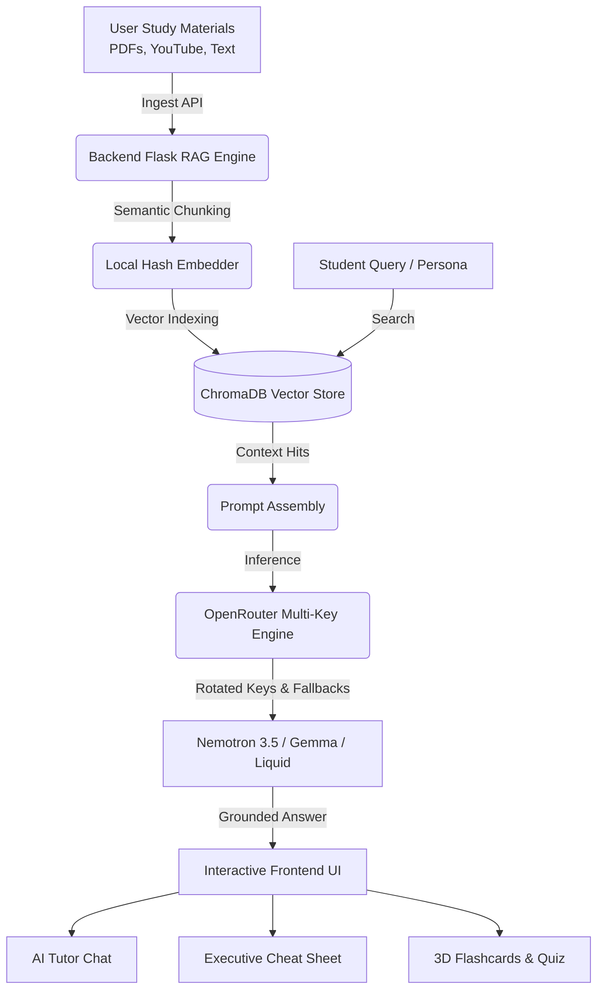

# NoteMind AI : AI Study Lab & Multi-Persona Tutor 🧠✨
> **Next-Generation Autonomous Student Study Lab & Multi-Persona AI Tutor**

[](https://reactjs.org/)
[](https://vitejs.dev/)
[](https://www.typescriptlang.org/)
[](https://python.org/)
[](https://www.trychroma.com/)
[](https://openrouter.ai/)
[](LICENSE)

NoteMind AI is a state-of-the-art AI-powered study companion. It transforms dense textbooks, PDFs, and YouTube lecture transcripts into active-recall flashcards, self-grading quizzes, structured executive cheat sheets, and adaptive AI tutor conversations across four pedagogical personas.

---

## 🌟 Key Features

### 1. 🎓 Multi-Persona AI Tutor (`/ask`)
Engage in contextual, grounded study conversations with an AI tutor that adapts to your learning style:
- **Standard Tutor**: Crisp, structured explanations with real-world examples and step-by-step clarity.
- **ELI5 Mode (Explain Like I'm 5)**: Intuitive real-world analogies (cooking, sports, gaming) and friendly emojis.
- **Professor Mode**: Academic lecture-grade rigor with formal principles and mathematical derivations.
- **Exam Cram Coach**: High-speed, high-yield cramming: must-know definitions, formulas, top exam traps, and memorable mnemonics.
- **Voice Interactivity & Text-to-Speech**: Hands-free studying with live microphone voice recognition and spoken responses.

### 2. ⚡ 1-Click Executive Cheat Sheets (`/study-lab`)
Generate comprehensive cheat sheets for any uploaded material or topic:
- **Executive Overview**: High-level synthesis of what matters.
- **Core Concepts Matrix**: Terms tagged by importance (*Core*, *High*, *Advanced*).
- **Exam Traps & Pitfalls**: Common misconceptions tested on exams.
- **Mnemonics & Key Formulas**: High-yield memory frameworks.
- **Instant Markdown Export**: 1-click clipboard copy for Obsidian, Notion, or paper notes.

### 3. 🃏 Interactive 3D Study Lab & Self-Grading Quiz (`/study-lab`)
- **3D Flip Flashcards**: Active-recall cards with smooth 3D flip animation, category tagging, and mastery status tracking.
- **Interactive Quiz Engine**: Multiple-choice questions with instant correct/incorrect feedback, answer explanations, and live score tracking.

### 4. 📚 Multi-Source RAG Pipeline (`/materials`)
- Ingest documents from **PDF files**, **plain text / markdown**, and **YouTube video URLs** (with automatic transcript extraction via `yt-dlp`).
- Indexed into **ChromaDB** using dense semantic vector embeddings.
- Precise chunk-level citation grounding with document references.

### 5. 🚀 High-Availability Cloud Inference (OpenRouter)
- Powered by high-speed OpenRouter API inference with **automatic multi-key rotation**.
- Multi-model fallback tier (`nvidia/nemotron-3.5-lightning:free`, `liquid/lfm-2.5-2.6b:free`, `google/gemma-4-26b-a4b-it:free`).
- Zero cold-start latency with instant local hash embedder for lightning-fast server startup (<0.1s).

### 6. 🎨 Modern Clean Light Design
- Crisp, clean white aesthetic with subtle glassmorphic navigation headers.
- Built with Tailwind CSS and Lucide icons for maximum readability during late-night study sessions.

---

## 🏛️ Architecture



---

## 🚀 Quickstart Guide

### Prerequisites
- **Node.js** (v18 or higher)
- **Python** (v3.10 or higher)
- **OpenRouter API Key** (Get free keys at [openrouter.ai](https://openrouter.ai/keys))

---

### 1. Clone the Repository
```bash
git clone https://github.com/saran-hash/NoteMind-AI.git
cd NoteMind-AI
```

---

### 2. Configure Environment Variables
Copy the example files and supply your OpenRouter API keys:

```bash
# Root environment (Frontend)
cp .env.example .env

# Backend environment
cp backend/.env.example backend/.env
```

Edit `backend/.env`:
```env
HOST=127.0.0.1
PORT=5000
open_router_key=your_openrouter_api_key_here
open_router_key_2=your_optional_second_key_here
OPENROUTER_MODEL=nvidia/nemotron-3.5-lightning:free
```

---

### 3. Start the Backend
```bash
# Set up virtual environment
python -m venv .venv

# Activate virtual environment
# Windows:
.\.venv\Scripts\Activate.ps1
# macOS/Linux:
source .venv/bin/activate

# Install dependencies
pip install -r backend/requirements.txt

# Run the backend server
python backend/app.py
```
> The backend server will start on `http://127.0.0.1:5000`.

---

### 4. Start the Frontend
In a new terminal window:
```bash
# Install dependencies
npm install

# Start development server
npm run dev
```
> Open **`http://localhost:8080`** in your browser!

---

## 🔌 API Reference

| Endpoint | Method | Description |
|---|---|---|
| `/api/health` | `GET` | Service health check and loaded model status. |
| `/api/ingest` | `POST` | Ingests PDFs, plain text, or YouTube lecture URLs into ChromaDB. |
| `/api/ask` | `POST` | RAG retrieval + persona-grounded tutor answer generation. |
| `/api/study/cheatsheet` | `POST` | Generates structured executive cheat sheets from study materials. |
| `/api/study/quiz` | `POST` | Generates active-recall flashcards and multiple-choice quizzes. |

---

## 🛠️ Technology Stack

- **Frontend**: React 18, Vite, TypeScript, Tailwind CSS, Lucide React, Canvas Confetti.
- **Backend**: Python 3.11, Flask, Flask-CORS.
- **Vector Database**: ChromaDB (dense semantic indexing).
- **Embeddings**: Fast zero-network vectorizer with fallback compatibility.
- **Document Extractors**: `pypdf`, `youtube-transcript-api`, `yt-dlp`.
- **LLM Inference**: OpenRouter Cloud API (NVIDIA Nemotron 3.5, Google Gemma, Liquid AI).

---

## 📄 License
This project is licensed under the MIT License — see the [LICENSE](LICENSE) file for details.
